<a name="top"></a>

<p align="center">
  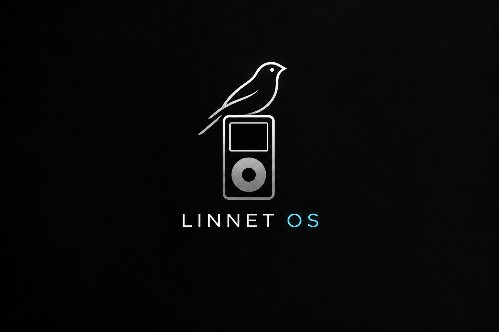
</p>

# Linnet OS

Linnet is firmware for iPod Photo / Color, iPod Video, iPod classic, and
fourth-generation monochrome iPods. The project includes a bootloader, kernel,
on-device interface, Windows Media Manager, USB development tools, and a UI
simulator.

- **Share music with Apple software.** Prepare compatible iTunes-synced music
  for Linnet, and add supported MP3s from `/Music` to the Apple library.
  See [sharing requirements](docs/apple-stock-music.md#supported-boundary).
- **Preparation on your computer.** Media Manager builds library indexes,
  artwork, photos, and video conversions for the iPod's display and playback
  formats, so the device can use prepared data.
- **Video on iPod Photo.** Convert videos on your computer and play them with
  sound on the Photo / Color's display.
- **Desktop media and menu controls.** Manage playlists, select games, and
  configure the iPod's Home, Music, Settings, and Extras menus in Media Manager.
- **Click-wheel menus and themes.** Browse media through click-wheel menus with
  configurable shortcuts and selectable themes.
- **Linnet Link.** Developer firmware provides two-way USB communication for
  live diagnostics, remote input, screenshots, and loading test firmware into RAM.
- **Native UI authoring.** Create screens in TSX, compile them into native
  firmware, and preview them with the desktop simulator.
- **Startup selection.** Choose Linnet, preserved Apple software, or a compatible
  installed Rockbox image from the startup menu.

https://github.com/user-attachments/assets/817822ca-d996-4715-b997-5a7aa66d4191

[Watch the demo on YouTube](https://youtu.be/mB3y4ezb6fE).

## Contents

- [Confirmed hardware](#confirmed-hardware)
- [Get started](#get-started)
  - [Install a packaged build](#install-a-packaged-build)
  - [Startup selection](#startup-selection)
  - [Add media](#add-media)
  - [Remove Linnet](#remove-linnet)
- [Music playback](#music-playback)
- [Linnet Media](#linnet-media)
- [Linnet Link](#linnet-link)
- [Games](#games)
- [Themes](#themes)
- [Simulator](#simulator)
- [Develop on Windows](#develop-on-windows)
  - [Build firmware](#build-firmware)
  - [Open Media Manager from source](#open-media-manager-from-source)
  - [Preview the interface](#preview-the-interface)
  - [Build for Linnet Link](#build-for-linnet-link)
  - [Package firmware and the Windows app](#package-firmware-and-the-windows-app)
- [Explore the project](#explore-the-project)
- [License](#license)
- [Credits](#credits)

## Confirmed hardware

| iPod family | Firmware ZIP prefix | Features |
| --- | --- | --- |
| Photo / Color | `linnet-photo4g` | Music, photos, prepared IPVF video, Cover Flow, games |
| Video | `linnet-video5g` | Music, photos, H.264/MPEG-4 video, Cover Flow, games |
| Classic 6G, 6.5G and 7G | `linnet-classic6g-7g` | Music, photos, native MP4 video, Cover Flow, games |
| Fourth-generation monochrome | `linnet-ipod4g` | Music and a monochrome interface |

The [hardware guide](docs/hardware.md) lists tested models, storage
configurations, target IDs, and feature limits. Classic requires PATA storage;
CE-ATA is not supported. See [storage compatibility](docs/storage.md) for disk
and filesystem requirements.

## Get started

### Install a packaged build

1. Download **LinnetSetup.exe** and the firmware ZIP for your iPod from
   [Releases](https://github.com/jspann21/linnet/releases), or use the files
   from a local build.
   Choose `-user.zip` for regular use or `-dev.zip` for diagnostics and Linnet Link.
2. Run the installer and open **Linnet** from the Start menu. The optional
   `linnet-media-windows.zip` runs without installation after extraction.
3. Connect the iPod with USB and choose **Find or switch iPod**. If necessary,
   use the Apple Disk Mode instructions on the **iPod setup** screen.
4. In **iPod setup**, choose **Choose ZIP…** and select the firmware ZIP without
   extracting it. Media Manager reads its model and build type automatically.
   Choose **Install firmware** and follow the prompts. Initial Classic setup
   includes instructions for entering DFU mode; Media Manager handles the
   subsequent bootloader and OS installation.
5. A fresh Classic finishes in Linnet Disk Mode: open **Preparation** to add
   media, then **Eject safely** to start Linnet. For other installation routes,
   eject safely to start Linnet, then enter **Settings → USB Disk Mode** on the
   iPod and reconnect before preparing media.

The Windows installer supports Windows 10 and later with x64 application
support. The app includes its runtime and media preparation dependencies.
Prebuilt User and Developer firmware ZIPs work without a compiler, Python
installation, or WSL.

Firmware installation checks the connected device, preserves existing media
and Apple firmware, and saves recovery backups. Device writes require Windows
administrator approval. See the [installation guide](docs/media-manager.md#install-or-restore-firmware)
for requirements and recovery instructions.

### Startup selection

Hold **MENU** during startup to open Linnet's boot selection menu. Select
Linnet, Apple iPod software, or a compatible installed Rockbox image from the
available entries.

To change the default, open **iPod setup → Startup** in Media Manager, choose a
system under **Start automatically**, and select **Save**.

### Add media

In Media Manager, open **Music**, **Photos**, **Videos**, or **Notes** and add
files or folders. Choose **Preparation → Prepare selected media**, then
**Eject safely** and restart Linnet.

### Remove Linnet

In Media Manager, open **iPod setup**, find **Remove Linnet**, and choose
**Remove…**. Removal restores the saved previous startup software and removes
Linnet's system files, settings, and prepared libraries. Original Music, Photos,
Videos, and Notes folders are kept. Follow the
[removal instructions](docs/media-manager.md#reinstall-or-remove-linnet)
for recovery requirements and the Classic's additional steps.

## Music playback

Now Playing shows album artwork and track information. Browse albums with
Cover Flow, or open playback options for shuffle, repeat, sound, and the sleep
timer.

<table>
  <tr>
    <td align="center"><a href="docs/images/now-playing-black-balloon.png">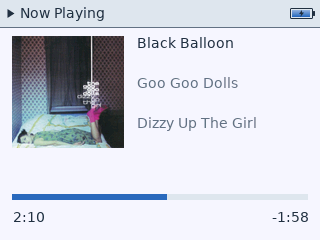</a><br>Now Playing</td>
    <td align="center"><a href="docs/images/cover-flow.png"></a><br>Cover Flow</td>
    <td align="center"><a href="docs/images/playback-options.png">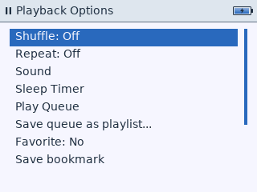</a><br>Playback options</td>
  </tr>
</table>

Select an image to view it at full size.

## Linnet Media

Media Manager is the Windows desktop app for firmware installation and media
preparation. It provides:

- Song, album, artist, and genre views, with library and artwork preparation.
- Photo and video conversion for the selected device, with progress reporting
  and reusable computer caches.
- Game installation and removal, and on-device menu configuration.
- Firmware installation, startup selection, updates, removal, and recovery.

<p align="center">
  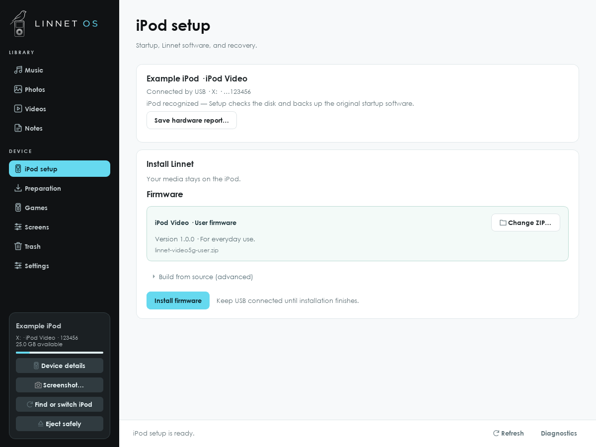
</p>

Media Manager's iPod setup screen with example device information and a User
firmware ZIP selected. See the [Media Manager guide](docs/media-manager.md).

## Linnet Link

Linnet Link is the USB interface for development and trace builds. It supports
button and wheel input, framebuffer capture, diagnostics, temporary RAM boot,
and persistent OS updates. User OS builds exclude this development interface.

Link operates while Linnet is running. Media library transfers use Disk Mode;
firmware replacement stops playback and follows the update procedure. Temporary
RAM boot does not replace the installed OS.

See the [Link guide](docs/device-link.md) for commands, image requirements,
readiness checks, and update behavior.

## Games

Photo, Video, and Classic support 18 native games: Comet Run, Pulse Path,
Solitaire, Sudoku, Brick, Music Quiz, Vortex, Minesweeper, Falling Blocks,
Reversi, Snake, Word Search, Scrub, Dial Heist, Mixtape, Signal, Clockwork City,
and Pocket Pinball.

Games are separate target-specific native packages. Choose games in Media
Manager, save, eject, and restart Linnet. See
[game authoring](docs/game-authoring.md) for the package format, templates,
controls, and preview tools.

<table>
  <tr>
    <td align="center">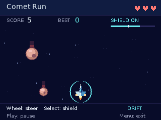<br>Comet Run</td>
    <td align="center">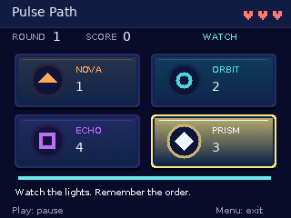<br>Pulse Path</td>
    <td align="center">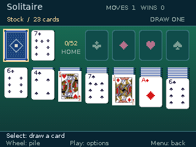<br>Solitaire</td>
  </tr>
</table>

Native game previews using the iPod Video's 320 × 240 layout.

## Themes

Supported color targets provide selectable themes and an **Album Colors**
option that uses colors from the current album's artwork. Theme layouts,
palettes, and included fonts are compiled into firmware. The monochrome target
uses its own interface.

Licensed fallback fonts are included. For Apple Podium Sans on supported color
themes, open **Media Manager → Settings → iPod appearance → Choose font →
Download and use Apple font**. The app downloads verified firmware from Apple
and extracts the font on the computer. Eject safely and restart Linnet to apply
it. See [font setup](docs/media-manager.md#ipod-theme-font) for details.

### Now Playing in different themes

The same track on iPod Video in six themes:

<table>
  <tr>
    <td align="center"><a href="docs/images/now-playing-black-balloon.png"></a><br>Linnet</td>
    <td align="center"><a href="docs/images/now-playing-midnight.png">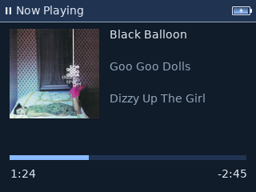</a><br>Midnight</td>
    <td align="center"><a href="docs/images/now-playing-album-colors.png">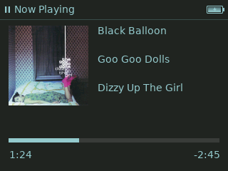</a><br>Album Colors</td>
  </tr>
  <tr>
    <td align="center"><a href="docs/images/now-playing-classic-split.png">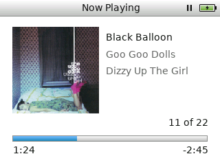</a><br>Classic Split</td>
    <td align="center"><a href="docs/images/now-playing-minimal-dark.png">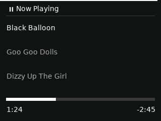</a><br>Minimal Dark</td>
    <td align="center"><a href="docs/images/now-playing-minimal-light.png">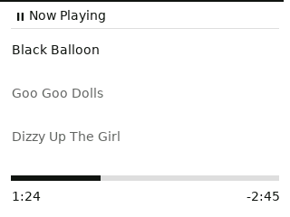</a><br>Minimal Light</td>
  </tr>
</table>

<details>
<summary>All 15 theme previews</summary>

<table>
  <tr>
    <td align="center"><a href="docs/images/home.png"></a><br>Linnet</td>
    <td align="center"><a href="docs/images/theme-midnight.png">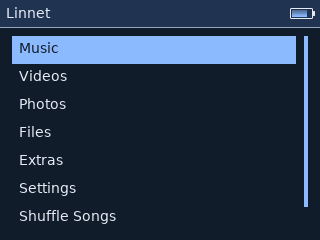</a><br>Midnight</td>
    <td align="center"><a href="docs/images/theme-graphite.png">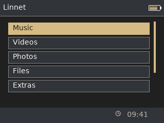</a><br>Graphite</td>
    <td align="center"><a href="docs/images/theme-aurora.png">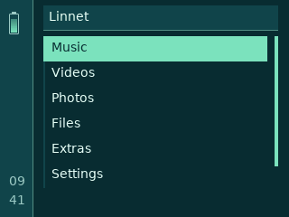</a><br>Aurora</td>
  </tr>
  <tr>
    <td align="center"><a href="docs/images/theme-sunset.png">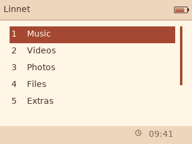</a><br>Sunset</td>
    <td align="center"><a href="docs/images/theme-blueprint.png">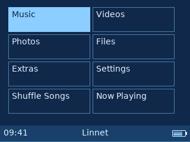</a><br>Blueprint</td>
    <td align="center"><a href="docs/images/theme-album-colors.png">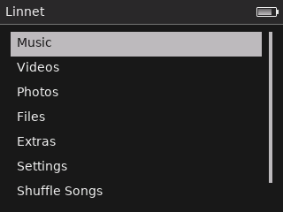</a><br>Album Colors</td>
    <td align="center"><a href="docs/images/theme-classic-split.png">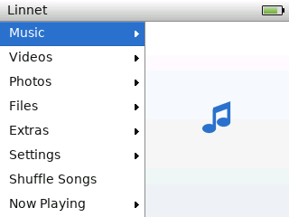</a><br>Classic Split</td>
  </tr>
  <tr>
    <td align="center"><a href="docs/images/theme-minimal-dark.png">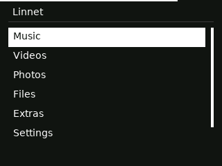</a><br>Minimal Dark</td>
    <td align="center"><a href="docs/images/theme-minimal-light.png">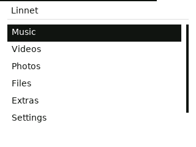</a><br>Minimal Light</td>
    <td align="center"><a href="docs/images/theme-ipod-photo.png">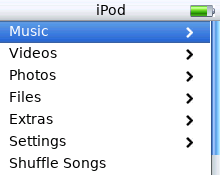</a><br>iPod Photo</td>
    <td align="center"><a href="docs/images/theme-ipod-classic.png">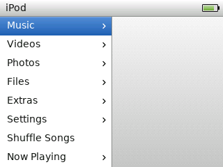</a><br>iPod Classic</td>
  </tr>
  <tr>
    <td align="center"><a href="docs/images/theme-classic-cobalt.png">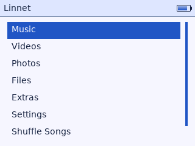</a><br>Classic Cobalt</td>
    <td align="center"><a href="docs/images/theme-classic-ember.png">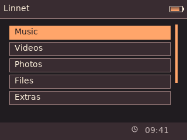</a><br>Classic Ember</td>
    <td align="center"><a href="docs/images/theme-ipod-mono.png">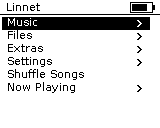</a><br>iPod Mono</td>
    <td></td>
  </tr>
</table>

Native simulator captures of all 15 selectable themes. Each preview uses a
supported iPod layout; theme availability and layout vary by model. Select an
image to view its native size. See the [UI SDK](sdk/README.md) for screen and
theme definitions.

</details>

## Simulator

The desktop simulator uses the firmware's native renderer and compiled UI
definitions. It renders screens to PNG, replays wheel and button events from
input tapes, and generates a browser report. Hardware timing, sound, USB, and
physical display behavior require testing on an iPod.

<table>
  <tr>
    <td align="center"><br>Home screen</td>
    <td align="center">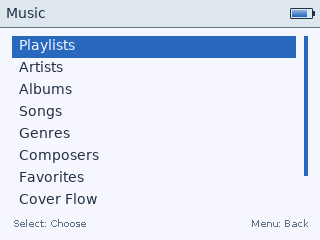<br>Music menu</td>
  </tr>
</table>

These previews use sample screens without personal library data.
[Simulator commands](#preview-the-interface) are included below.

## Develop on Windows

Install Git for Windows and **Python 3.14 x64**, then run:

```powershell
git clone https://github.com/jspann21/linnet.git
cd linnet
python -m venv .venv
.\.venv\Scripts\python.exe -m pip install -r tools/studio/requirements.txt
.\.venv\Scripts\python.exe linnet setup
.\.venv\Scripts\python.exe linnet doctor
```

Setup downloads and verifies the pinned LLVM 23.1.2 Windows compiler and builds
the native Apple database helpers. Media Manager, firmware builds, and the
simulator run on Windows without WSL.

### Build firmware

```powershell
.\.venv\Scripts\python.exe linnet build --target photo4g-p98 --profile release --verify
```

Use the target ID from the [hardware guide](docs/hardware.md) for other models.
Build artifacts are written to a unique
`out/<profile>/<target>/<kind>/runs/` directory. The command reports their paths;
building an image does not install it.

Linnet's bootloader, kernel, services, and UI use native code and fixed memory
budgets. Host tools prepare media indexes, fonts, and artwork. Static TSX UI
definitions are compiled to C; the device has no JavaScript runtime. See
[architecture](docs/architecture.md) and the [UI SDK](sdk/README.md).

### Open Media Manager from source

```powershell
.\.venv\Scripts\python.exe linnet media
```

For media conversion when running from source, install a Windows FFmpeg build
containing both `ffmpeg.exe` and `ffprobe.exe`. Put them on `PATH` or choose
their folder under **Settings → Advanced preparation → FFmpeg (source builds)**.
See [audio and video preparation](docs/media-manager.md#audio-and-video-preparation).

To compile during installation, open **iPod setup → Build from source
(advanced)**, enable **Compile firmware on this computer**, and choose User or
Developer firmware. Developer firmware is bound to the detected iPod. Source
compilation requires the configured compiler; selecting a prebuilt ZIP uses
that ZIP's recorded build type.

### Preview the interface

```powershell
.\.venv\Scripts\python.exe linnet simulator --target photo4g-p98 --all-scenes --output out/simulator
Start-Process out/simulator/index.html
```

Use the target's `system.toml` to select apps and the default theme. The SDK
contains screen templates and input-tape examples.

### Build for Linnet Link

Development and trace images require the device serial:

```powershell
.\.venv\Scripts\python.exe linnet build --target photo4g-p98 --profile dev --device-serial YOUR_SERIAL --verify
```

Replace `YOUR_SERIAL` with the detected device's serial and use its target ID.
See the [Link guide](docs/device-link.md) for discovery, input, screenshots,
RAM boot, and persistent updates.

### Package firmware and the Windows app

```powershell
.\.venv\Scripts\python.exe -m pip install -r tools/studio/requirements-build.txt
.\.venv\Scripts\python.exe linnet release bundle --target photo4g-p98 --build user --output out/releases/linnet-photo4g-user.zip
.\.venv\Scripts\python.exe linnet release bundle --target photo4g-p98 --build dev --output out/releases/linnet-photo4g-dev.zip
.\.venv\Scripts\python.exe linnet release media --output out/releases/linnet-media-windows.zip --installer-output out/releases/LinnetSetup.exe
```

Repeat the bundle commands for the other targets. Packaging verifies the
firmware images and includes the User or Developer OS, both bootloader
variants, and prepared game packages where supported. Classic packages also
include the initial bootloader bootstrap.

Windows app packages include the runtime, media preparation tools, and native
Apple database helpers. FFmpeg and Apple helper sources and licenses accompany
those components; `linnet-source.zip` provides the matching project source.
Packaging prepares the pinned Inno Setup compiler under `out/toolchains/`.
Output files must not already exist.

The [GitHub workflow](.github/workflows/build.yml) builds eight firmware ZIPs
and the Windows app on version-tag pushes (`v*`), pull requests, and manual
runs. Tag builds also create a draft release with downloads, source, and checksums.
See [builds and releases](docs/releases.md) for the naming and publishing steps.

For an existing compiler installation, set `LINNET_LLVM_BIN` to its `bin`
directory. `doctor` checks the pinned version. Linux firmware development
requires LLVM 23.1.2 on PATH; the desktop app is Windows-only. See
[bootstrap tooling](docs/bootstrap-tooling.md) for target-specific build and
installation details.

## Explore the project

The [documentation index](docs/README.md) lists user guides and developer
references.

| Topic | Documentation |
| --- | --- |
| Media preparation, firmware installation, and removal | [Media Manager](docs/media-manager.md) · [Storage compatibility](docs/storage.md) |
| Screens, apps, and themes | [UI SDK](sdk/README.md) · [UI compiler](docs/ui-compiler.md) |
| Native game packages | [Game authoring](docs/game-authoring.md) |
| USB development interface | [Linnet Link](docs/device-link.md) |
| Firmware structure and file formats | [Architecture](docs/architecture.md) · [Binary formats](docs/formats.md) |
| Media formats | [Music](docs/music-format.md) · [Photos](docs/photo-format.md) · [Video](docs/video-format.md) |
| Device compatibility and porting | [Hardware support](docs/hardware.md) · [Porting guide](targets/README.md) |
| Contributions and planned work | [Contributing](CONTRIBUTING.md) · [Roadmap](docs/roadmap.md) |
| Build outputs and recovery records | [Local artifacts](docs/local-artifacts.md) |

## License

Copyright (C) 2026 jspann21 and Linnet contributors.

Unless otherwise stated, Linnet's original code, documentation, and assets are
licensed under the GNU General Public License, version 3 or (at your option) any
later version ([GPL-3.0-or-later](LICENSE)). You may use, modify, and redistribute
them under those terms. Linnet comes without any warranty; see the license for
details.

Installation and use are at your own risk. To the extent permitted by law,
the copyright holders and contributors are not liable for device damage,
unusable devices, data loss, or repair and recovery costs. See the
[warranty and liability notice](NOTICE.txt).

Third-party code, fonts, and artwork retain their own licenses and copyright
notices. The project license does not grant rights to Apple-derived assets;
see the [font and theme notes](sdk/README.md) and the
[Podium Sans notice](sdk/assets/PODIUM-SANS-NOTICE.txt).

## Credits

The firmware incorporates third-party codecs, libraries, and adapted
algorithms, including components sourced through Rockbox. Their licenses and
origins are recorded in [third-party provenance](third_party/README.md), the
[SDK's font and theme notes](sdk/README.md), and the
[game artwork credits](targets/photo4g-p98/README.md).

[Back to top](#top)
